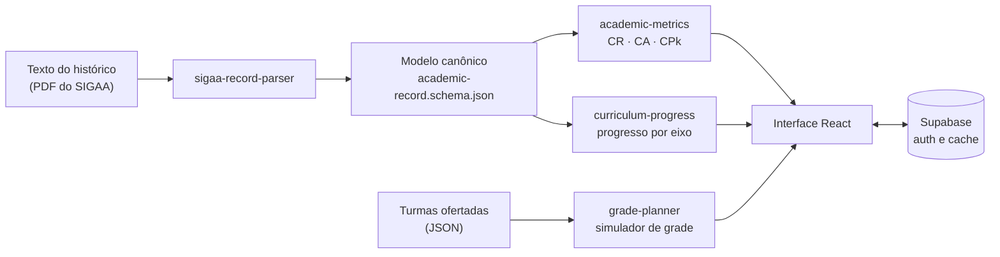

# CoreUFABC

**Protótipo de planejamento acadêmico para alunos da UFABC: do histórico do SIGAA ao próximo quadrimestre.**

  

<!-- Adicione uma captura em docs/tela.png (com histórico de exemplo, nunca o seu real) e descomente:
 -->

## O problema

A UFABC organiza a graduação em quadrimestres e em um bacharelado interdisciplinar (BC&T ou BC&H) que se ramifica em formações específicas. Saber quanto falta em cada categoria de crédito e montar uma grade possível exige cruzar o histórico do SIGAA, as regras do projeto pedagógico e a oferta de turmas, quase sempre à mão.

## O que o protótipo faz

- **Importa o histórico** colado do PDF do SIGAA e o converte em um modelo canônico de disciplinas (código, créditos, categoria, conceito, quadrimestre e situação), incluindo linhas quebradas pelo PDF.
- **Calcula métricas acadêmicas** seguindo o Guia da Graduação: CR, CA e CPk, com os pesos oficiais dos conceitos e créditos T+P.
- **Mostra o progresso por eixo** do currículo, separando disciplinas obrigatórias, de opção limitada e livres.
- **Simula a grade** do próximo quadrimestre a partir das turmas ofertadas, com quadro de horários.
- **Reporta erros de importação de forma anônima**, removendo do texto tudo o que não pertence ao vocabulário estrutural do SIGAA.

## Arquitetura



Regras, parsing e apresentação ficam separados: o cálculo não conhece a interface, e o parser não conhece o cálculo. Isso permite testar cada parte isoladamente.

## Decisões técnicas

- **Fonte normativa explícita.** As métricas seguem o Guia da Graduação da Prograd. Onde o produto precisou de uma métrica própria (afinidade por formação), ela é marcada como métrica de produto, não como índice oficial. Detalhes em [`docs/data-curation-and-metrics.md`](docs/data-curation-and-metrics.md).
- **Contrato de dados com schema.** O histórico normalizado segue [`docs/academic-record.schema.json`](docs/academic-record.schema.json), e os testes usam um histórico fictício.
- **Privacidade no relato de erro.** Quando a importação falha, o relato enviado mantém só a estrutura da linha, sem nome, RA ou conceitos.
- **Teste antes do build.** O `prebuild` roda a suíte, e o CI no GitHub Actions testa e gera o build a cada push.

## Como executar

Requer Node.js 22.

```bash
npm ci
cp .env.example .env    # preencha VITE_SUPABASE_URL e VITE_SUPABASE_ANON_KEY
npm run dev             # http://localhost:5173
npm test                # 66 testes em 10 suítes
```

Sem as variáveis do Supabase, a interface abre com dados de exemplo; login e cache ficam desativados.

## Estrutura

```text
src/
  services/   parser do SIGAA, métricas, APIs e diagnóstico
  utils/      progresso curricular e planejador de grade
  components/ interface (dashboard, simulador, importação)
  data/       currículos e turmas ofertadas
supabase/functions/sigaa-fetch/   função de importação direta do SIGAA
tests/        66 testes com node:test
docs/         contrato de dados, parser e manutenção
```

## Limitações

- É um protótipo pessoal, sem usuários além de testes próprios.
- A importação direta do SIGAA passa as credenciais do aluno por uma função no Supabase, que não as armazena. Para uso real, o caminho recomendado é a importação pelo texto do PDF, que não exige senha.
- Os currículos e a oferta de turmas estão em arquivos JSON e precisam ser atualizados a cada quadrimestre.

## Autoria

Desenvolvido por **Vitor Tosti** com apoio de assistentes de código.
